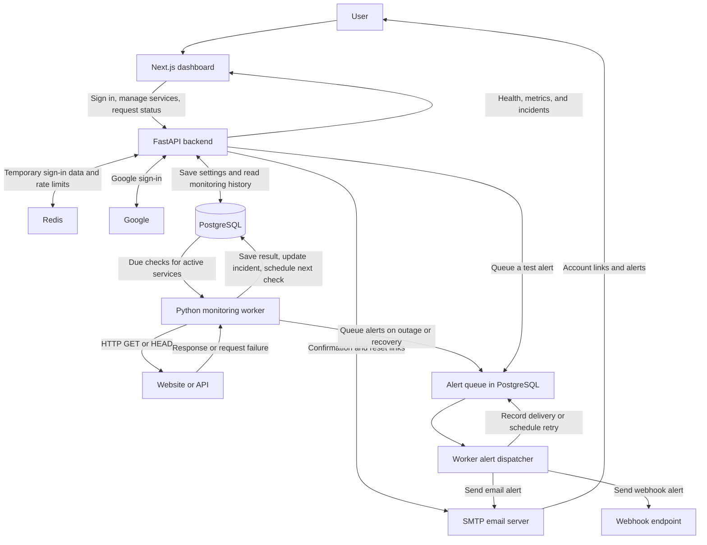

# PulseGrid

## What is the project?

PulseGrid is a self-hosted uptime monitor for websites and HTTP APIs. It checks whether services are responding and alerts you when they go down or recover.

## What does it do?

- Add a service by URL and set how often to check it. Edit, pause, or resume checks. Archive and restore services to keep their history, or delete a service and its history.
- View current health, uptime, check coverage, response times, and outage history. The dashboard shows when checks are missing or stale.
- Receive outage and recovery emails at your account address when email alerts are enabled and SMTP is configured. Send a test email from the dashboard or configure webhook alerts through the API. The worker retries failed deliveries and records their outcomes.
- Sign in with Google or a verified email and password. Manage password recovery, authenticator-based two-factor authentication, and active sessions.

## How does it work?

- The **Next.js** dashboard calls a **FastAPI** backend to manage services and display monitoring data. In production, **Caddy** routes browser traffic to the dashboard and API.
- **PostgreSQL** stores accounts, service settings, check schedules, results, incidents, and queued alerts. **Redis** stores temporary sign-in data and tracks rate limits.
- A separate **Python worker** takes due checks from PostgreSQL and sends HTTP requests with **HTTPX**. Checks use GET by default, with HEAD available through the API. The worker records the HTTP status and time to response headers, or the error if the request fails.
- Two consecutive failed checks open an incident. Two consecutive successful checks close it. The worker saves the incident change and queues alerts for enabled destinations in the same database transaction. It sends queued alerts by SMTP or webhook and updates their delivery status.

The authenticator input is adapted from [Rare UI](https://rareui.com).

## Working Flowchart

