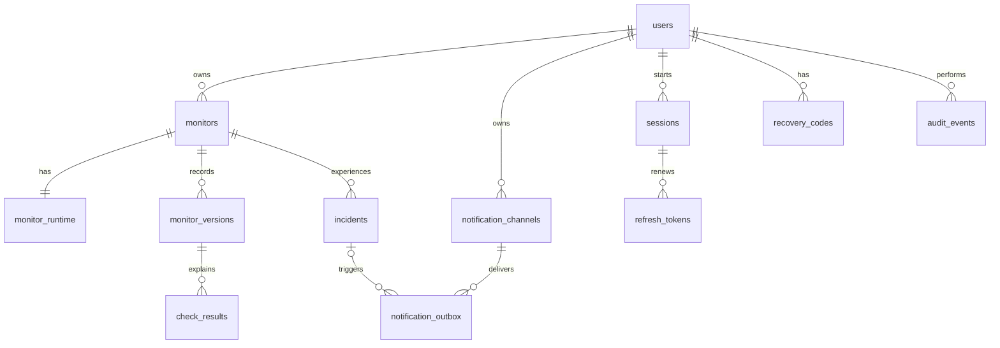

# PulseGrid data model

Schema revision `0005` has **13 application tables**, plus Alembic's migration bookkeeping table. Users own monitors directly. Enabled notification destinations cover all current and future monitors belonging to their owner.

| Table | Responsibility |
| --- | --- |
| `users` | Email, password hash, Google identity, encrypted MFA secret and replay protection. |
| `sessions` | Login lifetime, revocation, browser label and recent activity. |
| `refresh_tokens` | Hashed renewal tokens, consumption and replacement history. |
| `recovery_codes` | Hashed single-use MFA backup codes. |
| `monitors` | Owner, current check settings, configuration counter, pause and archive state. |
| `monitor_runtime` | One current state/schedule/worker lease per monitor. |
| `monitor_versions` | Historical settings and active/paused/archive periods. |
| `check_results` | Individual completed checks linked to the configuration actually used. |
| `incidents` | Confirmed outage and recovery times, with optional supporting checks. |
| `notification_channels` | Owner, encrypted email/webhook configuration and enablement. |
| `notification_outbox` | Durable queued alerts, retries, delivery leases and outcomes. |
| `audit_events` | Who performed an action, resource type/ID and when; no secret values. |
| `worker_heartbeats` | Background worker freshness and in-flight work. |

## Checks and history

`monitors` holds current settings. Every create, edit, pause, resume, archive or restore creates a new `monitor_versions` row and closes the previous period in the same transaction. The API locks the monitor before changing its version/runtime so concurrent edits cannot lose configuration periods. Only one version may be current.

Each result references both its monitor and a matching version. A composite foreign key prevents linking a check to another monitor's settings. Editing a URL preserves the original URL for checks already saved. A worker holding an older configuration or expired lease cannot commit a new result.

The migration preserves legacy activity intervals and check rows, but earlier URLs/methods/timeouts were never recorded. Those periods use `settings_known=false` and unknown fields stay NULL. Checks outside previously recorded activity periods receive an unknown, inactive history record; the migration does not invent coverage. A known current settings period begins at migration time.

Configuration history is available at `GET /api/v1/monitors/{id}/versions` and under **More details → Configuration history**. Check responses include `monitor_version_id`. The history endpoint is paginated; the interface shows the latest 100 periods.

## Ownership and alerts

Monitors and notification destinations each reference their owner directly. The worker selects only enabled destinations with that same owner. There are no groups or routing rules in this release. Old group API paths and the `bucket_id`/`all_groups` request fields are removed; obsolete request fields are rejected rather than silently changing coverage.

Checks, current health, incident transitions and alert queue entries commit together. A unique scheduled check key, a single-open-incident index and an incident/event/channel uniqueness rule prevent duplicate records. External delivery remains at least once: a crash after provider acceptance can cause a duplicate delivery.

Retiring an incident clears its outbox reference instead of deleting queued alerts. The alert payload retains the incident context. Explicitly deleting a destination still deletes its delivery history; the interface asks for confirmation. Disabling a destination retains pending deliveries for later resumption.

## Archiving and deletion

Archiving stops future checks, hides the monitor from the normal dashboard, and preserves its history. Use the dashboard's **Show archived services** control or `GET /api/v1/dashboard?archived=true`. History remains accessible by monitor ID. Restoring resumes the monitor unless it was already individually paused. Archive/restore fence in-flight checks just like edits and pauses.

`POST /api/v1/monitors/{id}/archive` and `/restore` perform those operations. Permanent deletion requires `DELETE /api/v1/monitors/{id}?confirm_history=true` and removes the monitor, settings periods, raw checks and incidents. Pending alert records survive incident deletion and retain their payload context.

## Database guardrails and retention

PostgreSQL checks enforce supported methods/status codes, valid interval/timeout ranges, nonnegative finite measurements/counters, paired lease fields, known runtime states and valid period/incident timestamps. Accepted status codes use a typed integer array. Foreign keys and uniqueness protect record relationships.

Raw checks retain 30 days by default, security/audit/delivery history 90 days and closed incidents 365 days. Cleanup runs in bounded batches; indexes support retention queries. Only completed or exhausted deliveries are eligible for delivery cleanup. Old worker heartbeats are removed after a day. Expired sessions and their tokens are removed together; used refresh-token hashes remain while their session is live so replay detection continues to work. Settings versions remain until their monitor is permanently deleted.

## Migration and rollback

Stop all API/worker processes, take a verified backup and preserve the matching source release before applying `0005`. The migration copies ownership directly from old groups, converts group pauses into individual monitor pauses, preserves settings/checks/authentication/delivery records, and clears old worker/delivery leases. Existing session IDs and token digests remain valid.

A channel with `all_groups=false` blocks migration before any schema changes. Review its saved rules and explicitly convert its coverage or retire it before retrying. The migration never silently broadens selective alerts. If selective per-monitor routing is a product requirement, add an explicit linking table in a separate design instead of bypassing the guard.

The removed tables are `buckets` and `notification_rules`. `monitor_activity` becomes `monitor_versions`; `session_families` becomes `sessions`. Group information is destructive to remove, so downgrade deliberately refuses to invent it. Rollback requires the pre-migration dump and matching source archive. The current restore helper rejects archives from the older schema before touching the selected database.

This workspace's pre-migration source and development/staging/capacity dumps are under ignored `backups/pre-model-change/`; the final development dump and preservation baseline are under `backups/pre-model-change/final/`. Protect these files and the original encryption key.
